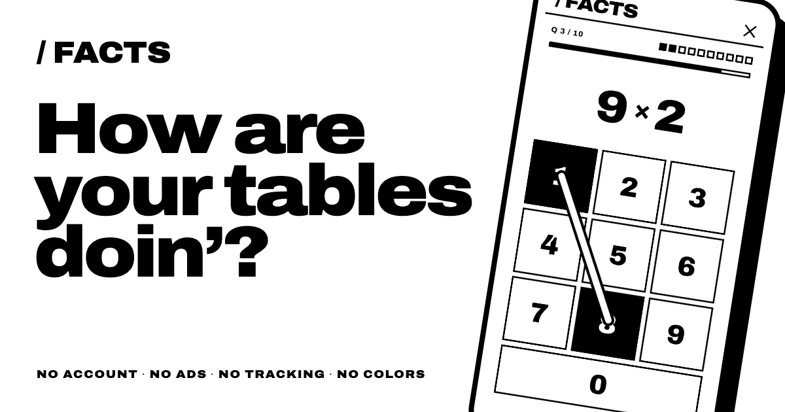
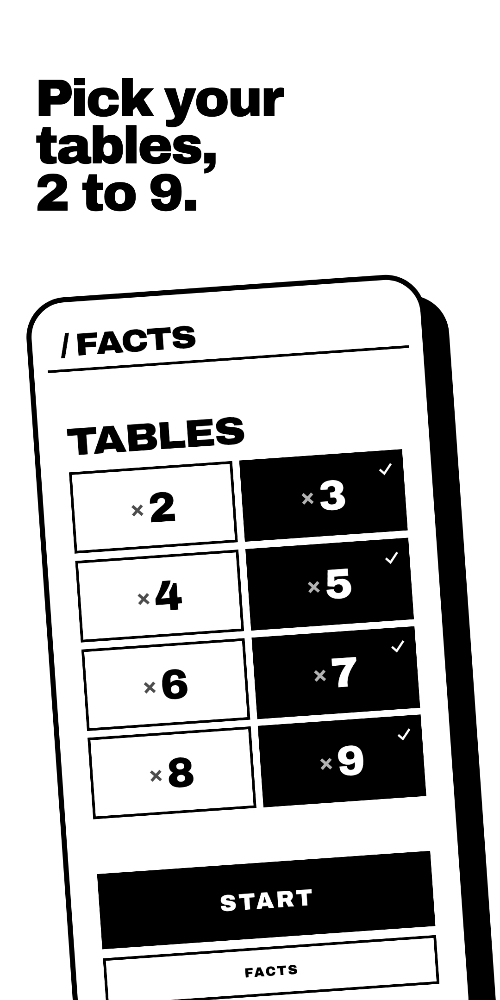
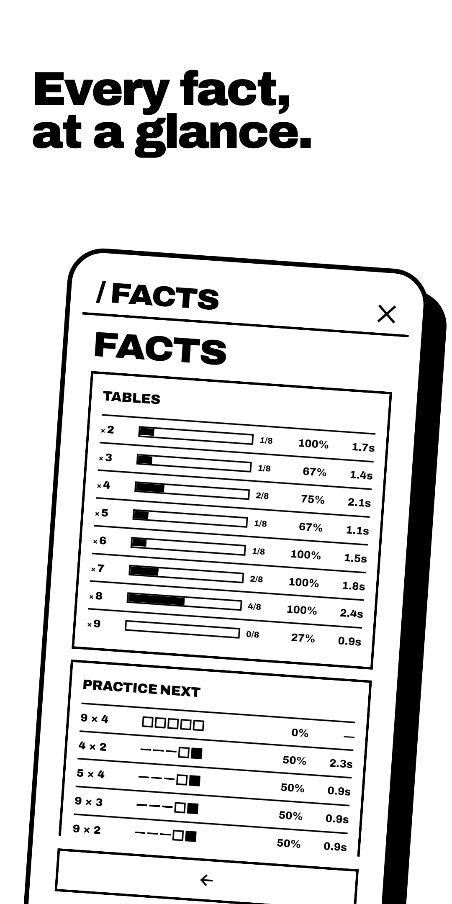

<p align="center">
  
</p>

<h1 align="center">/ FACTS</h1>

<p align="center">
  <strong>Multiplication tables 2–9, answered with a single stroke.</strong><br />
  See → remember → slash → next.
</p>

**SlashFacts** is a free times-tables trainer for Android, iOS and the web. Practise
remembering the answer, not calculating it.

<p align="center">
  <a href="https://slashfacts.proto.fish">Play on the web</a> ·
  <a href="https://apps.apple.com/us/app/slashfacts-times-tables/id6834372742">App Store</a> ·
  <a href="https://play.google.com/store/apps/details?id=fish.proto.slashfacts">Google Play</a> ·
  <a href="https://f-droid.org/packages/fish.proto.slashfacts/">F-Droid</a>
</p>

The web version is also installable as a PWA.

<p align="center">
  <a href="docs/design.md">How it works</a> ·
  <a href="CONTRIBUTING.md">Contribute</a>
</p>

<p align="center">
  <a href="LICENSE"></a>
  
  
</p>

<p align="center">
  
</p>

---

## How to play

Choose tables **2–9** and recall each answer within **6 seconds**. Draw through its
digits: for `7 × 8 = 56`, stroke from **5** to **6**. Only starts, ends and turns
count; digits crossed straight through are ignored. Tap for a one-digit answer.

- **Rounds of 10** favour facts you miss or answer slowly.
- **After a miss**, the answer is shown and the same fact returns until correct.
  Repeating the shown answer earns no tick.
- **FACTS** gives a permanent tick for answering right *first time*, at least once;
  it is not a speed rating.
- Android and iOS provide **haptic feedback**.

Black and white, heavy type, no decoration or cartoon rewards. No partial credit:
an answer is right or needs more practice.

<p align="center">
  
  
  
</p>

## Private by design

No accounts, analytics or ads; no analytics, advertising or crash-reporting SDKs.
Progress stays on your device, not on a server. Website hosting may keep standard
request logs, such as IP addresses. The Android **release** requests only `VIBRATE`.
See the [privacy policy](apps/mobile/public/privacy.html).

<p align="center">
  
</p>

## Run it locally

```sh
npm install
npm run dev      # the app in a browser, on http://localhost:8081
npm test         # engine + gesture tests
npm run build    # website build in apps/mobile/dist
npm start        # serve that build on $PORT
```

For the native app, run `cd apps/mobile && npx expo start` and open it in Expo Go.

## Under the hood

One Expo / React Native app serves all three platforms. The pure, dependency-free
TypeScript engine in `packages/core` owns facts, adaptive scheduling and gesture
reading. Fork and adapt the free software under its license.

- 📐 [**Design rules**](docs/design.md): how a stroke becomes digits, why the 1 and 10
  tables are out, why a round's score is not a level.
- 🧱 [**Architecture**](docs/architecture.md): code layout, storage, the mobile app,
  deployment.
- 📚 [**All docs**](docs/README.md): design, architecture, decision records, licensing audit, F-Droid.

## Contributing

**Start with an issue** describing the need, benefit and fit with the app's purpose
and simplicity. For bugs, include reproduction steps and expected behaviour.
Discussion does not guarantee integration. **Open a pull request only when a
maintainer asks in the issue**; see [CONTRIBUTING.md](CONTRIBUTING.md).

Sign off every commit (`git commit -s`) to certify the
[Developer Certificate of Origin](https://developercertificate.org/).

## License

SlashFacts is made by **PROTO/fish** and released under the
[GNU General Public License v3.0](LICENSE). The app icon and brand mark are covered by the
same license.

The Archivo typeface (`apps/mobile/assets/fonts`) is © The Archivo
Project Authors and licensed under the [SIL Open Font License 1.1](apps/mobile/assets/fonts/OFL.txt).
