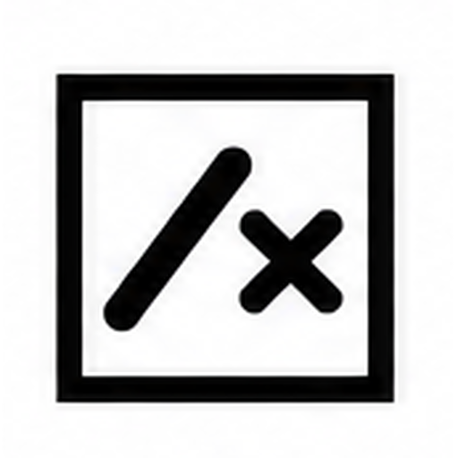
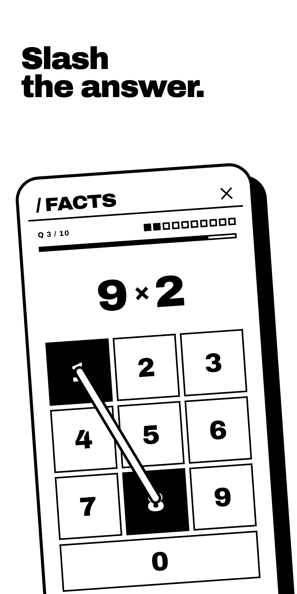
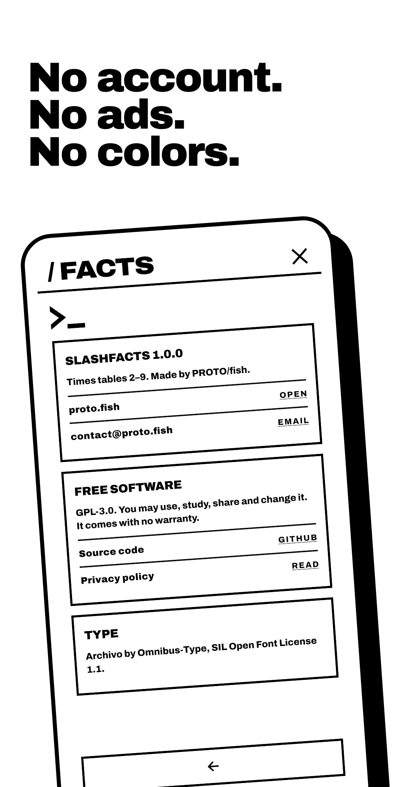

<p align="center">
  
</p>

<h1 align="center">/ FACTS</h1>

<p align="center">
  <strong>Multiplication tables 2–9, answered with a single stroke.</strong><br />
  See → remember → slash → next.
</p>

**SlashFacts** is a free times-tables trainer for Android, iOS and the web. Practise
remembering the answer, not calculating it.

<p align="center">
  <a href="https://slashfacts.proto.fish">Play on the web</a> ·
  <a href="https://apps.apple.com/us/app/slashfacts-times-tables/id6834372742">App Store</a> ·
  <a href="https://play.google.com/store/apps/details?id=fish.proto.slashfacts">Google Play</a> ·
  <a href="https://f-droid.org/packages/fish.proto.slashfacts/">F-Droid</a>
</p>

The web version is also installable as a PWA.

<p align="center">
  <a href="docs/design.md">How it works</a> ·
  <a href="CONTRIBUTING.md">Contribute</a>
</p>

<p align="center">
  <a href="LICENSE"></a>
  
  
</p>

<p align="center">
  
</p>

---

## Answer with a stroke

A question appears, and you answer by **drawing one line through the digits of the
result**. For `7 × 8 = 56`, draw from **5** to **6** on the pad. The stroke is read by
where it *starts*, *ends* and *turns*; digits passed straight through are ignored.
A single tap works for a one-digit answer.

<p align="center">
  
  
  
</p>

## Practise recall

Choose the tables you want to practise, from **2 to 9**. Each question gives you
**6 seconds** to remember the answer and draw it. The aim is to know the fact without
working it out.

- **Practise what needs work.** Each round of 10 leans on facts you get wrong or answer slowly.
- **Try again after a miss.** The answer is shown, then the same fact returns until you
  answer correctly. Repeating the answer just shown does not earn a tick.
- **One tick per fact.** The **FACTS** map ticks a fact once it has been answered right
  *first time*, at least once. That tick stays; it is not a speed rating.
- **Feel each answer.** Haptic feedback on Android and iOS.

## Simple on purpose

The aim is the simplest possible app for practising these facts. Every element is there
for a use: the clock sets the pace, the pad takes the answer, and the map shows what has
been answered right first time. Black and white, heavy type, no decoration or cartoon
rewards. There is no partial credit: either the answer is right, or it needs more practice.

## Private by design

No account, no server-side data, no analytics, no ads, no third-party SDKs. Progress is
stored on the device and nowhere else. On Android the app asks for exactly one permission,
`VIBRATE`. See the [privacy policy](apps/mobile/public/privacy.html).

<p align="center">
  
</p>

## Run it locally

```sh
npm install
npm run dev      # the app in a browser, on http://localhost:8081
npm test         # engine + gesture tests
npm run build    # website build in apps/mobile/dist
npm start        # serve that build on $PORT
```

For the native app, run `cd apps/mobile && npx expo start` and open it in Expo Go.

## Under the hood

One Expo / React Native app runs on Android, iOS and the web. Its pure TypeScript core,
`packages/core`, holds the facts, adaptive scheduler and gesture reader, with no dependencies.
The code is free software: fork it and adapt it to your needs under the license below.

- 📐 [**Design rules**](docs/design.md): how a stroke becomes digits, why the 1 and 10
  tables are out, why a round's score is not a level.
- 🧱 [**Architecture**](docs/architecture.md): code layout, storage, the mobile app,
  deployment.
- 📚 [**All docs**](docs/README.md): design, architecture, decision records, licensing audit, F-Droid.

## Contributing

For an upstream change, **start with an issue**: explain the need, why the change helps,
and how it fits the app's purpose and simplicity. For a bug, include steps to reproduce it
and what you expected. A discussion does not guarantee that a change will be integrated.
**Open a pull request only when a maintainer asks for one in the issue**; see
[`CONTRIBUTING.md`](CONTRIBUTING.md).

Every commit needs a `Signed-off-by` line (`git commit -s`), certifying the
[Developer Certificate of Origin](https://developercertificate.org/).

## License

SlashFacts is made by **PROTO/fish** and released under the
[GNU General Public License v3.0](LICENSE). The app icon and brand mark are covered by the
same license.

The Archivo typeface (`apps/mobile/assets/fonts`) is © The Archivo
Project Authors and licensed under the [SIL Open Font License 1.1](apps/mobile/assets/fonts/OFL.txt).
